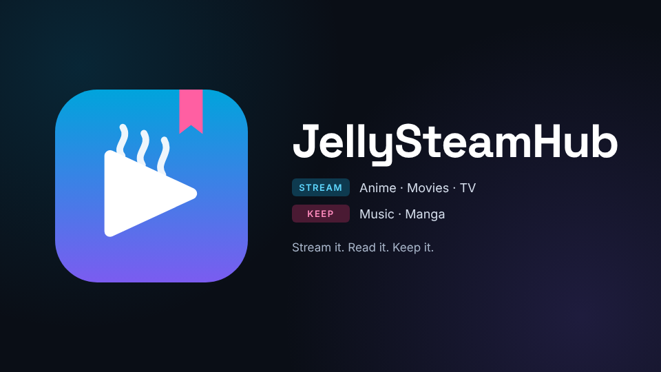

<p align="center"></p>

<p align="center"><b>Anime, movies, TV, music and manga in Jellyfin — streamed, not stored.</b></p>

<p align="center">
  <a href="https://github.com/ItzDabbzz/jellyfin-plugin-streamfin/releases/latest"></a>
  <a href="#install"></a>
  <a href="https://github.com/ItzDabbzz/jellyfin-plugin-streamfin/actions/workflows/compat.yml"></a>
  <br>
  <a href="https://github.com/ItzDabbzz/jellyfin-plugin-streamfin/actions/workflows/build.yml"></a>
  <a href="https://github.com/ItzDabbzz/jellyfin-plugin-streamfin/actions/workflows/security.yml"></a>
  <a href="https://scorecard.dev/viewer/?uri=github.com/ItzDabbzz/jellyfin-plugin-streamfin"></a>
  <a href="LICENSE"></a>
</p>

<p align="center">
  <a href="#install">Install</a> ·
  <a href="#features">Features</a> ·
  <a href="#settings">Settings</a> ·
  <a href="#subsonic-apps">Subsonic</a> ·
  <a href="#how-it-works">How it works</a> ·
  <a href="#build">Build</a>
</p>

## What it is

StreamFin adds four channels to Jellyfin. Catalogs supply the titles; video, audio and manga pages are fetched when you press play or open a chapter. Everything else behaves like a normal library — progress, resume, subtitles, search and user access.

| | Channel | What you get |
| --- | --- | --- |
| 🗡️ | **Anime** | Popular, This Season and A–Z from AniList · HiAnime, AnimeGG and AnimeHeaven · Japanese audio, English subs only |
| 🍿 | **Movies & TV** | Popular movies, Popular TV and Trending from TMDB · played from FlixHQ |
| 🎵 | **Music** | Lossless FLAC from Monochrome · Deezer and YouTube fallbacks · radio · save to library |
| 📖 | **Manga** | 90 sources · CBZ downloads into a Jellyfin library · built-in reader |

Nothing is downloaded ahead of time. The only media kept on disk is the song cache and the manga you asked for.

## Features

### Anime

- **Browse** — Popular, This Season and A–Z from AniList, with covers and episode lists.
- **Play** — HiAnime, AnimeGG or AnimeHeaven. The first provider that has a series becomes Season 1; the others appear as "Also on" seasons.
- **Subtitles** — Japanese audio with English subtitles only, never a dub.
- **Provider fallback** — a failed episode can be retried on another enabled provider, but only for the same episode number; ambiguous titles are rejected.
- **Filters** — hide adult and ecchi titles, based on AniList tags.

### Movies & TV

- **Browse** — Popular movies, Popular TV and Trending from TMDB.
- **Play** — movies start directly, shows open into seasons and episodes; streams come from FlixHQ.
- **Key** — the channel stays hidden until a free TMDB API key is saved. The short API key and the long read access token both work.

### Music

- **Lossless** — FLAC from [Monochrome](https://github.com/monochrome-music/monochrome)'s catalog: CD quality, 24-bit on some albums, streamed as-is. Only a Subsonic app that asks for a lower bit rate gets a converted file.
- **Browsing** — real album pages with numbered tracks, artist pages with top tracks, albums and singles, **Starred**, **Recently played**, and synced lyrics from [LRCLIB](https://lrclib.net).
- **Radio** — **Instant Mix** on an artist, album or song mixes top tracks with similar artists, as [ListenBrainz](https://listenbrainz.org) listeners play them. A free Last.fm key fills the gaps.
- **Cache** — played songs stay on the server (4 GB by default, 0 turns it off) for instant skips and replays. The next song in the queue or album can be fetched while one plays.
- **Save to library** — starred albums are saved as tagged FLAC (`Artist/Album (Year)/01 Title.flac`) into a folder you add as a normal music library.
- **Catalog fallback** — when Monochrome is slow or down, searches and album/artist pages come from [Deezer](https://www.deezer.com) (metadata only, no audio). Songs then play from Monochrome by ISRC, or from YouTube.
- **YouTube fallback** — off by default. A song the catalog cannot send plays as AAC at about 128 kbps via yt-dlp. Favourites are upgraded to FLAC in the background once the catalog is back. A proxy setting covers servers YouTube blocks.

### Manga

- **Sources** — 90 in the built-in catalog, 7 on by default. Each source has its own pacing, priority, download limit and a test button.
- **Search & request** — search every enabled source, request a series, and monitor it for new chapters.
- **Downloads** — CBZ archives into a folder your Jellyfin manga or books library reads. Optional AVIF conversion, a 50 GiB storage budget by default, retry/pause/cancel.
- **Reader** — a manga button in the Jellyfin header (needs the File Transformation plugin), plus the full reader from the settings page. Progress and bookmarks are per user.
- **Metadata** — an optional ComicVine key adds publisher, year, credits and summary to `ComicInfo.xml`.

### Everywhere

- **Jellyfin search** — online results appear beside library results, tagged `Streamable` and `StreamFin`.
- **Layout** — separate channels, one hub, or both; an optional **Stream online** entry inside a local library.
- **Access** — nobody sees anything until ticked; an app password alone grants nothing.
- **Subsonic** — the music channel speaks OpenSubsonic, for Symfonium, Feishin, Tempo and friends.

## Install

**Jellyfin 12.3 or newer.**

1. Add the repository under **Dashboard › Plugins › Repositories**:
   ```
   https://github.com/ItzDabbzz/jellyfin-plugin-streamfin/releases/latest/download/manifest.json
   ```
2. Install **StreamFin** from the catalog (under **Channels**), then restart Jellyfin.
3. Open **Dashboard › Plugins › StreamFin**, turn it on, and tick the users allowed in.
4. For **Movies & TV**, paste a free [TMDB API key](https://www.themoviedb.org/settings/api).
5. Add any of the extras below.

| Optional | Adds |
|---|---|
| TMDB API key | Movies & TV — required for that channel |
| [File Transformation](https://github.com/IAmParadox27/jellyfin-plugin-file-transformation) | Manga button in the Jellyfin header |
| FFmpeg with libaom-av1 | AVIF manga pages (smaller files) |
| ComicVine API key | Manga publisher, year, credits, summary |
| Last.fm API key | Similar artists when ListenBrainz has none |

The channels appear on the home screen and in the sidebar. If one is missing, check that your user is ticked and the TMDB key is saved, then reload the app.

<details>
<summary><b>Channel icons in the web app</b></summary>

The web app gives channels a generic icon. Make an API key under **Dashboard › API Keys**, then run this from a clone:

```sh
JELLYFIN_TOKEN=... python3 scripts/web-icon.py --url https://your.jellyfin --channel Anime
JELLYFIN_TOKEN=... python3 scripts/web-icon.py --url https://your.jellyfin --channel "Movies & TV"
JELLYFIN_TOKEN=... python3 scripts/web-icon.py --url https://your.jellyfin --channel Music
```

</details>

## Settings

Everything lives on one page, in six sections:

| Section | Controls |
|---|---|
| **Navigation** | Channels, hub or both · hub name · Stream online rows · online results in Jellyfin search |
| **Sources** | Anime providers and fallback · adult/ecchi filters · TMDB key · music source order, live state, Test now |
| **Playback & cache** | Song cache size · next-song prefetch · catalog cache lifetime · favourites folder |
| **Manga** | Storage folder and Jellyfin library · ComicVine key · storage budget · check interval · AVIF · concurrency · per-source pacing |
| **User access** | One card per user: access and Subsonic app passwords |
| **Maintenance** | Clear caches · warm catalogs · update YouTube tools |

## Subsonic apps

Music also speaks OpenSubsonic, so apps like Symfonium, Feishin, Tempo or play:Sub get gapless playback, queues, offline downloads and synced lyrics.

In the settings under **User access › Subsonic apps**, turn the API on and press **New password** next to a user. In the app, pick Subsonic or OpenSubsonic and enter:

| Field | Value |
|---|---|
| Server | `https://your.jellyfin/StreamFin` |
| Username | the Jellyfin username |
| Password | the app password, not the Jellyfin one |

The catalog has no list of everything, so the library an app syncs is yours: what you played, starred or put in a playlist, plus every album of the artists you star or keep playing. Ratings, play counts and the play queue live on the server, so another device picks up where you stopped.

App passwords travel in the request address, like Jellyfin's own tokens, so they can show up in Jellyfin and reverse-proxy logs. Keep those private; **New password** revokes the old one.

## How it works

- **Catalogs and sources are separate.** AniList, TMDB and Monochrome supply titles, posters and episode lists. A source only has to turn "this episode" into a video URL.
- **Jellyfin never sees that URL.** It gets a loopback address into the plugin with a one-off ticket. MP4 streams as byte ranges, and HLS playlists are rewritten so every segment points back at the relay.
- **Music takes the short path.** One FLAC per track with byte ranges, so Jellyfin plays the bytes unchanged, with seeking and no transcode.
- **Fallbacks are ordered.** A slow search can go to the next source. After repeated failures the catalog is skipped for a while, and what it already answered comes from disk. YouTube is last, and off until you turn it on.
- **The relay is not a general proxy.** It accepts only its own tickets, only from loopback, and only public destinations. Nothing from the sites is run — except YouTube's player code in deno, only when the fallback is on.
- **The YouTube tools are checked.** yt-dlp and deno come from their official releases, verified against the published SHA-256, and update daily. Set your own paths if you prefer; use the glibc builds on Alpine.

## Build

Needs Docker, Python 3 and Bash — no local .NET:

```sh
bash scripts/fetch-references.sh
bash scripts/build.sh
```

That runs the tests and writes the plugin zip to `artifacts/`.

CI does the same on every push, plus CodeQL, a secret scan over the whole history and a workflow lint. Every Monday it loads the plugin on the newest Jellyfin, and every third-party parser is fuzzed on each pull request.

### Bump a version

The version lives in one place: `<Version>` in `src/StreamFin.csproj`. Bump it, commit, then tag the commit with the same version prefixed by `v`. Pushing the tag publishes the release.

```sh
# 1. src/StreamFin.csproj: <Version>0.12.0.9</Version>
git commit -am "chore: bump version to 0.12.0.9"

# 2. annotated tag - its body becomes the release notes and the manifest changelog
git tag -a v0.12.0.9 -m "StreamFin 0.12.0.9" -m "- fix: ..." -m "- feat: ..."

# 3. publish
git push origin main
git push origin v0.12.0.9
```

The release workflow rejects a tag that does not match the csproj version. On a match it runs the release checks and the tests, builds the zip, signs its provenance, appends the version to `manifest.json` (starting from the previous release's copy) and publishes the GitHub release. Do not edit or commit `manifest.json` by hand, and do not push a `v*` tag you do not want released.

## Why this fork

Upstream is [mmrmagno/StreamFin](https://github.com/mmrmagno/jellyfin-plugin-streamfin). This fork reorganizes the source layer for easier maintenance and adds manga — downloading, managing and reading it next to the streaming channels.

## Credits

The AnimeGG and AnimeHeaven adapters are adapted from the MIT-licensed [Seanime providers](https://github.com/Seanime-contributions/Seanime-Providers). The HiAnime flow follows [ani-cli](https://github.com/pystardust/ani-cli), written from scratch. FlixHQ is a port of my (mmrmagno) own downloader. Icons are from Material Design Icons. Details in [`THIRD_PARTY_NOTICES.txt`](THIRD_PARTY_NOTICES.txt).

StreamFin hosts nothing. It plays what third-party sites already serve, and whether that is legal where you live is on you.

## License

[GPL-2.0](LICENSE).
